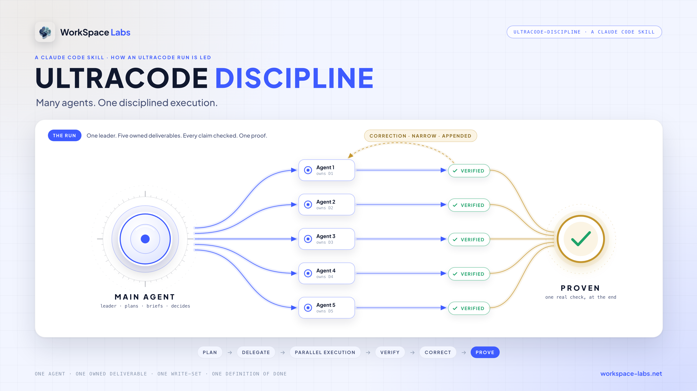
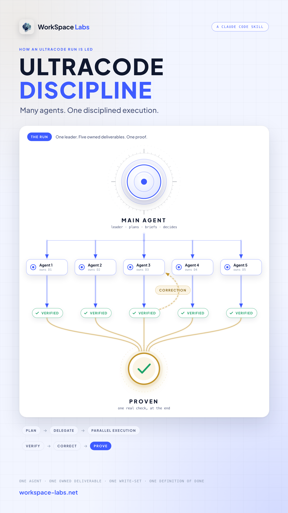

# ultracode-discipline



**Disciplined multi-agent execution for Claude UltraCode.**

UltraCode lets Claude Code put many agents on one task. This skill is the small governance layer that keeps the main agent in charge of the run: one agent owns one deliverable and one write-set, the contracts are fixed before any agent starts, every write is checked by an agent that did not do it, a wrong brief stops instead of improvising, and a failed check is corrected by appending, never by restarting. It changes how Claude leads. It does not replace UltraCode or the Workflow engine, and it never restates what Claude Code's built-in `workflow-authoring` reference already says.

The skill is one file — [`skills/ultracode-discipline/SKILL.md`](skills/ultracode-discipline/SKILL.md). **Claude Code only.**

---

## The six rules

The built-in `workflow-authoring` reference already covers the script mechanics: schemas, pipeline vs barrier, resume, the journal, the token budget and the quality patterns. This skill adds only what that reference does not say:

1. **One agent = one deliverable + one write-set.** Writers never overlap; readers may. Two agents work the same deliverable only when comparing them is the stated purpose. Write-sets are counted from the decomposition, never from the size of the change: three or more fan out, however small each part is; fewer than three get no fan-out at all.
2. **Contracts before fan-out.** The leader fixes interfaces, names and shapes first. No agent changes one; an agent that finds one wrong returns `blocked`. The leader's own edits to anything the agents read land before the fan-out or after the run, never during it.
3. **Checker ≠ doer.** Every *write* deliverable is verified by an agent that did not build it. Read-only deliverables get no verifier. Audits use the reference's adversarial-verify pattern instead.
4. **Blocked means stop.** A wrong or incomplete brief comes back as `blocked` with a reason, never improvised past. A missing result is a failure, never a silence.
5. **Correct by appending.** At most two in-run correction rounds, each appended and re-verified. Never retry an unchanged brief, never relaunch a run for one failure. The leader runs the project's real test or build once at the end.
6. **Declare the launch; a refusal is a no.** The workflow's own description — the line the approval dialog shows you before anything runs — is the launch line: `UltraCode: <n> agents · <phases> · why: …`. A fan-out through direct agent calls writes the same line as text first; fewer than three write-sets get `UltraCode: 0 agents · <n> write-set(s) — inline` and no fan-out. If you decline the Workflow dialog, that fan-out is over: Claude never re-runs the same agents through the Agent tool; it asks, or does the work inline and says so.

Every brief carries the same shape (goal, contract, write-set, done-when, evidence, out of scope, blocked, return-only-the-schema, "do the brief yourself; never spawn agents") and every agent returns the same schema (`done` | `blocked` | `unresolved`, with evidence; a checker's failures in `findings`).

---

## Automatic use

It loads on its own, first — before any file is read or written — only when UltraCode is on or the prompt says `ultracode`. It stays quiet for an ordinary agent spawn, a parallel read-only lookup, a workflow you asked for without the word, a conversation, a trivial edit or a board stage move. Every agent decides for itself when a skill applies, so it can miss one; `/ultracode-discipline` loads it by hand.

You can see it working: the Workflow approval dialog's description is the launch line, `UltraCode: <n> agents · <phases> · why: …`, so you read the count and the reason at the moment you approve or decline.

**Claude Code only.** It relies on Claude Code capabilities, the Agent and Workflow tools where they are available, and on the built-in `workflow-authoring` reference for the script mechanics. An agent without those tools stops reading at the skill's first line. Other Claude environments do not necessarily expose the same tools.

---

## Install

This repository is the source of truth. Claude Code reads skills from `~/.claude/skills/`.

One line, for every project on your machine:

```bash
npx skills add workspace-labs/ultracode-discipline -g
```

The `skills` CLI needs Node 22.20 or newer; on an older Node it stops with a syntax error before installing anything, so use one of the two git methods instead.

Or copy it by hand:

```bash
git clone https://github.com/workspace-labs/ultracode-discipline.git
mkdir -p ~/.claude/skills
cp -R ultracode-discipline/skills/ultracode-discipline ~/.claude/skills/
```

Or link it, so a `git pull` in the clone updates the installed skill:

```bash
git clone https://github.com/workspace-labs/ultracode-discipline.git
mkdir -p ~/.claude/skills
ln -s "$PWD/ultracode-discipline/skills/ultracode-discipline" ~/.claude/skills/ultracode-discipline
```

Claude Code indexes skills when a session starts, so open a fresh session after installing.

---

## Usage

Ask for the run the way you normally would. If the request qualifies, the skill governs it.

> ultracode: split the import module into a parser, a validator and a writer, each with its own tests, and make `npm test` pass.

The main agent lists three owned deliverables with disjoint write-sets, fixes the three interfaces, briefs three builders and three checkers, and hands you the approval dialog whose description is the launch line; after your approval it runs, corrects by appending if a check fails, then runs `npm test` once and reports with evidence.

`UltraCode: 6 agents · BUILD 3, VERIFY 3 · why: three modules with disjoint write-sets, each independently verified`

How many agents depends on the task, never on the skill: below three independent write-sets, UltraCode is not worth it and one agent in one pass is faster; from three up, roughly two per deliverable, the checker included, however small each part is.

<p align="center"></p>

---

## Scope and limits

- It governs delegation behavior. It does not replace the Workflow engine, its opt-in rule or its hard limits.
- It sets no fixed agent count. The main agent chooses the count from the real decomposition and says why in the launch line.
- It does not bypass platform or harness limits.
- Outside an intentionally enabled UltraCode run it removes, overrides, weakens or replaces no existing approval, cost or session rule.
- Many agents are not proof. Correctness comes from the independent checks and the one real run at the end, not from the head count.

---

## Validation

Version 1 (2026-09-25) passed:

- strict YAML and skill-structure validation;
- trigger validation in fresh Claude Code sessions: it loads for an UltraCode task and for a "use a workflow" fan-out, and stays quiet for a typo fix, a single lookup agent and plain conversation;
- Claude-only isolation checks: an install in Claude's skills folder is not mirrored into other agents' skill folders;
- a behavioral run on a throwaway project: one launch line, every return in the schema, a deliberately wrong brief surfaced as `blocked` rather than improvised, a narrow appended correction with the unchanged work replayed from cache instead of re-run, one final real test run, and no agent writing outside its write-set;
- trigger validation on Linux (2026-09-25): loads first for an `ultracode` prompt and for a session with ultracode on; stays quiet for a typo fix;
- an independent review with no material findings remaining open.

Version 2 (2026-10-09) narrowed the trigger to UltraCode only, dropped the verifier on read-only deliverables and the loaded line, and deferred everything the built-in reference already states. Re-validated the same day in fresh headless sessions on macOS (Claude Code 2.1.295): loads first for an `ultracode` prompt; stays quiet for a "use a workflow" ask, a typo fix and a three-agent lookup without the word. A behavioral run on a throwaway project (three modules, three builders, three independent checkers with a differential oracle, one final `npm test`, 20/20) found the gaps that became 2.1: the launch line was skipped, the schema had no field for a checker's failures, builders wrote prose reports instead of returning the schema, and a refused Workflow dialog was re-run through direct agents. All four are now rules. Re-tested headless, where the dialog is always refused: the refusal stopped the fan-out, the work was done inline and the refusal was disclosed; `findings` and the return-only-the-schema line appeared in every brief. The launch line as a chat line was skipped twice, so 2.1 binds it to the workflow's own description, which the approval dialog always shows.

Version 2.2 (2026-10-21) retested 2.1 on Claude Code 2.1.305 with the Claude Fable 5.1 model, this time with the Workflow engine really running (a headless session can now pre-approve the call). The trigger held, 9 of 9. The engine path held: six agents, disjoint write-sets, a checker per module that did not build it, every return through the schema. Two leaders failed the rules, and both failures became text: a leader called the README's own three-module split "one write-set" and stayed inline, twice — rule 1 now counts write-sets from the decomposition and names cost as a non-reason; a leader with the session switched on built everything before loading the skill — the description now says load it first, before any file is read or written. Re-run after the fixes: five of five runs fanned out as the rules say.

Validated on macOS and Linux (Ubuntu, Claude Code 2.1.282) with Claude Code. Not validated on Windows.

The full test record — every session, prompt, result and what was not tested, for 2.2 and 2.1 — is in [`TEST-EVIDENCE.md`](TEST-EVIDENCE.md).

---

## What it costs

- **Every fan-out gets a shape.** Contracts and complete briefs come before the first agent, so a run starts a little later and ends with proof.
- **Verification is extra agents.** Every write deliverable is checked by an agent that did not build it; readers are not.
- **The leader stays in the loop.** Several small workflows with the leader reading results between them, not one fire-and-forget run.

**Worth it when:** a task really splits into parts that different agents can own.

**Not worth it when:** one agent can do it well in one pass.

---

## The shortest version

> Give every agent one deliverable, one write-set, one definition of done. Fix the contracts first. Take nothing without evidence. Have a different agent check every write deliverable; read-only deliverables get no verifier. Correct narrowly. Prove it once, for real.

## Reminder: update every machine

The installed copy in `~/.claude/skills/` does not update itself. After a change lands in this repository, update the skill on **each** machine that runs Claude Code, including the Mac:

```bash
npx skills add workspace-labs/ultracode-discipline -g
```

If the skill is linked from a clone, run `git pull` in that clone instead. Then open a fresh Claude Code session; skills are indexed at session start.

Quick check that the installed copy is current: start a session with an `ultracode` prompt. The Workflow approval dialog's description should start with `UltraCode:`; an `ultracode-discipline: loaded` line, or an `est.` cost figure, means the old copy is still installed.

---

<sub>by Workspace Labs</sub>
